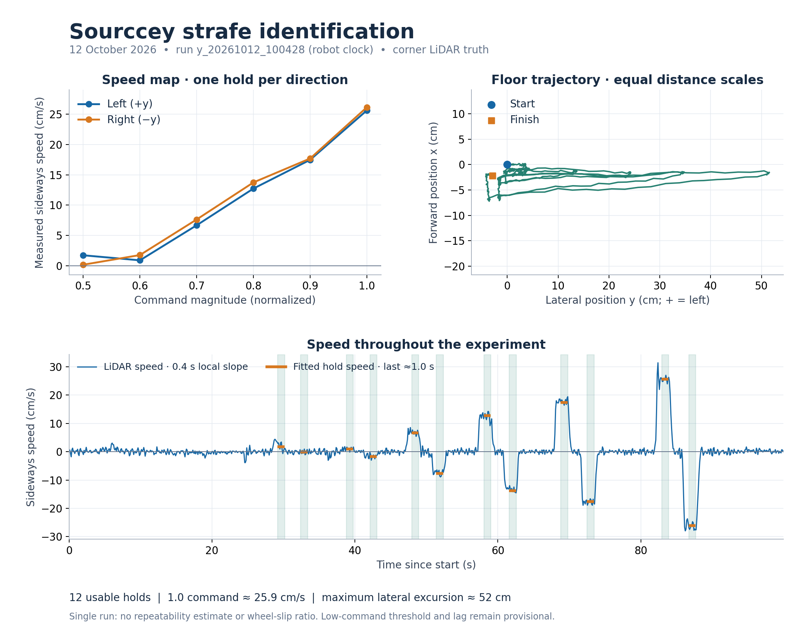
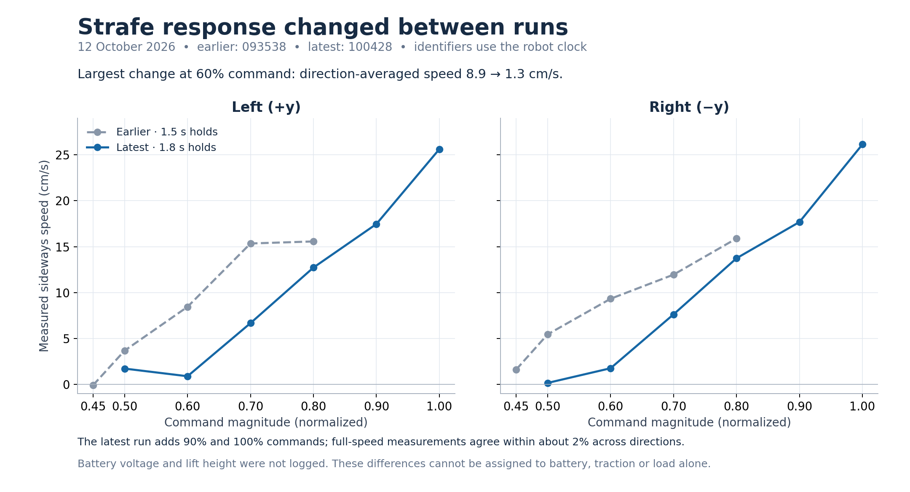

# First identified base response

The original controller maps normalized commands linearly to 0.6 m/s and 90°/s.
Real Sourccey measurements show a substantial low-command dead zone, much lower
top speeds, and response lag. The optional `identified` mode supplies measured
velocity targets through the existing wheel/contact simulation.

```python
from sourccey.simulation import Simulation

sim = Simulation(base_response="identified")
sim.set_base(left=0.8)
sim.step(1000)
sim.set_base()  # zero command; measured delay/lag applies to braking too
sim.step(500)
```

The desktop equivalent is `python -m sourccey.app --base-response identified`.
`ideal` remains the default. This PR does not change masses, collisions, mesh
assets or the floor traction law, and does not depend on the separate mass/dome PRs.

## Measurements and chosen parameters

The versioned source is [`sourccey/identified_base.json`](../sourccey/identified_base.json).
It includes tables, signed strafe holds, run IDs, units, fit RMS and limitations.

| Axis | Measurement | Positive / negative top speed | Lag τ | Delay |
| --- | --- | --- | --- | --- |
| Forward x | 2026-10-07, LiDAR wall range, two runs | 0.3197 / 0.3028 m/s | 0.200 s | 0.080 s |
| Strafe y | 2026-10-12, two-wall corner, run `100428` | 0.2587 / 0.2587 m/s (direction average) | 0.100 s | 0.100 s |
| Yaw | 2026-10-07, gyro checked against wall directions | 1.018 / 1.043 rad/s | 0.175 s | 0.020 s |

For strafe the LiDAR was 0.18 m ahead of the robot origin. The offline estimate
deskews scans for yaw and translation and separates lateral travel, forward drift
and heading. The latest run tracked 998 of 1002 scans, with twelve 1.8 s holds at
±0.5, ±0.6, ±0.7, ±0.8, ±0.9 and ±1.0. Each speed fit uses the portion after the
first 0.8 s. The measured full-speed holds were +0.2562 and −0.2613 m/s.

| Command magnitude | Chosen mean strafe speed (m/s) |
| --- | --- |
| 0.40 | 0 (regularization point) |
| 0.50 | 0.00943 |
| 0.60 | 0.01326 |
| 0.70 | 0.07150 |
| 0.80 | 0.13229 |
| 0.90 | 0.17574 |
| 1.00 | 0.25875 |

Speeds interpolate linearly between table points and are zero below 0.40.
That zero node avoids inventing gradual motion all the way down to zero command;
it is a modeling choice, not a precisely established universal breakaway threshold.
The noisy automatic slow-ramp thresholds are deliberately not used. The fitted
strafe speed RMS was 0.00985 m/s, an in-sample metric, not held-out validation.

The earlier strafe run `093538` used 1.5 s holds up to 0.8. The operator estimated
charge at about 100% then and 75% for the latest run. At command 0.6, mean speed
changed from 0.0889 to 0.0133 m/s; at 0.8, from 0.1573 to 0.1323 m/s. These runs
are **not averaged together**. The latest supplies the only complete strafe map;
the earlier signed holds remain in the JSON as evidence of operating variation.
Battery voltage and lift height were not logged, so no battery-charge law is fitted
and the difference cannot be attributed uniquely to charge. Forward and yaw were
measured on a different day and do not constitute one controlled battery condition.

## Identification plots



Run `y_20261012_100428`: twelve 1.8 s holds through ±100% command. The
direction-averaged full-command speed is 25.9 cm/s. Orange segments show the
steady speed fitted over the last approximately 1.0 s of each hold; the trajectory
also shows forward drift during the strafe experiment. These are hardware
measurements, not simulated results or a held-out model validation.



Runs `y_20261012_093538` and `y_20261012_100428`: the latest extends the measured
range to 90% and 100% command. At 60% command, direction-averaged speed changed
from 8.9 to 1.3 cm/s. The model uses the latest curve; this comparison documents
variation between runs. Battery voltage and lift height were not recorded, so it
does not establish a battery, traction or load correction.

## Runtime behavior and scope

For each axis, `v_target = table(command delayed by d)` and
`dv/dt = (v_target - v)/τ`. The controller integrates this exponential exactly
between delayed command changes, using simulation time. Brief pulses survive
the delay queue; Reset clears the velocity and pending commands. Forward and yaw
retain separate positive/negative tables; strafe uses a symmetric direction average.

The filtered body velocity is converted to CAD wheel rates using the existing
52 mm radius / 0.30 m lever convention. Wheel actuator limits still apply.
No chassis position, velocity or applied force is assigned by this response model.
Disabling traction or lifting wheels off the floor still prevents propulsion.

Important limits of this first model:

- The measurements are effective body responses, not motor shaft RPM or a wheel
  slip model. Existing contact forces and wheel inertia add their own transient
  response, so the final simulated lag is not guaranteed to equal the fitted lag.
- Individual-axis contributions are superposed for combined commands. The real
  host's per-wheel saturation, mixed-command dead zones and roller slip have not
  been identified. Combined motion is an approximation.
- One hold per sign/level gives no repeatability estimate. Battery, floor and load
  dependence remain unmodeled; no adaptive battery scaling is implied.
- The current CAD masses and idealized actuators remain. This is a useful first
  command-response model, not a complete validated digital twin.

Tests cover measured table points, directional signs, delay/lag at several time
steps, short delayed pulses, braking, reset, invalid input, and full-speed strafe
through the actual MuJoCo contacts. Windows packaging includes the JSON; the
packaged Windows executable itself must be built and smoke-tested on Windows.
